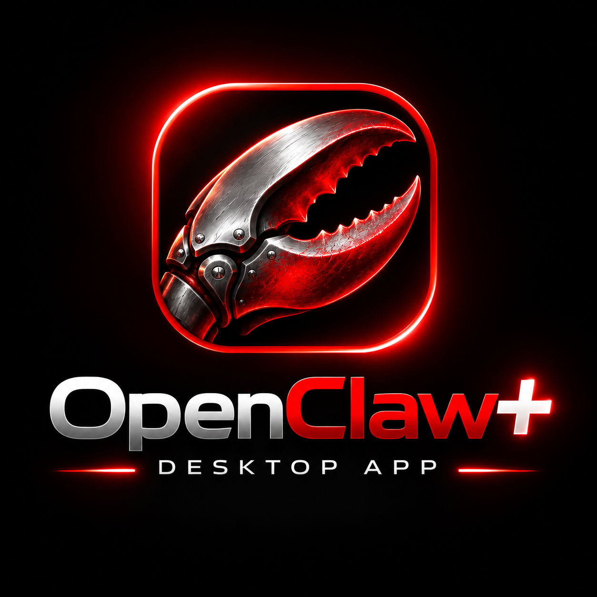

# OpenClaw+



An independent macOS desktop workspace for your existing OpenClaw installation. Keep conversations, agent activity, voice, terminal work and model profiles together while OpenClaw remains responsible for execution, authentication and permissions.

**OpenClaw+ is an unofficial project, not the official OpenClaw application.** This source builds **0.8.0-preview.6** for Apple Silicon macOS. It does not include an OpenClaw installation or model weights.

## What you can do

- Start or continue conversations, review tool activity, attach supported files and answer asynchronous questions.
- Browse slash commands in the composer, see context usage and choose a model or reasoning level while the conversation refreshes.
- Follow agent sessions, activity and existing automations; review native approval requests.
- Watch agent work, handoffs and coffee breaks in the read-only GlauxOS Office.
- Read reports aloud, dictate into a draft or talk through supported, configured OpenClaw voice providers.
- Open a terminal for a conversation and copy selected output into a message draft.
- Review a conversation's execution permissions and explicitly apply supported native modes.
- Browse available models, save personal references and open native provider setup.
- Use the independent **Governed Capability Broker (GCB)** to research supported model configurations, review benchmark usage, authorize a run and inspect capability bios, retained structured responses and explainable routing previews.

Light and dark themes, resizable panes, native menus and keyboard navigation are included. Registration, profiling and routing are separate: profiling never changes agent assignments, and live routing remains unavailable.

## Before you start

The preview supports **Apple Silicon macOS** and an existing local OpenClaw gateway. Live connection support currently requires:

| Requirement | Supported configuration |
| --- | --- |
| macOS | Bundle declares 13.0 minimum; this candidate was verified on 26.3.1 |
| Node executable | `/opt/homebrew/bin/node`, compatible with your installed OpenClaw |
| OpenClaw entry point | `/opt/homebrew/lib/node_modules/openclaw/openclaw.mjs` |
| Configuration | Default `~/.openclaw/openclaw.json`, readable as JSON |
| Gateway | Local mode, loopback bind, token or password authentication, TLS disabled |

Integration has been exercised with **OpenClaw 2026.11.1**, which declares Node **24.16–24.x or 26.1 and newer**. Alternative installation locations, named profiles, custom configuration paths, remote gateways, Intel Macs and other operating systems are not supported by this preview. Shell credential overrides are not forwarded.

Set up OpenClaw with its [official tools](https://docs.openclaw.ai/) first. OpenClaw+ does not install a gateway, create agents or copy credentials into the interface. Keep the original OpenClaw interface available for administration and recovery.

## Open the app

From a reviewed source checkout, with Node.js **22.12 or newer** for the build tools:

```sh
cd desktop
npm ci
npm run setup:electron
npm start
```

The separate Electron setup downloads the pinned desktop runtime. An active macOS graphical session is required. The build-tool Node minimum does not replace OpenClaw's higher runtime requirements.

To build a local application, run `npm run package` from `desktop`, then open `releases/0.8.0-preview.6/OpenClaw+-darwin-arm64/OpenClaw+.app` from the repository root in Finder. See [building and verification](docs/BUILDING.md) for the full procedure.

The [Releases page](https://github.com/Leogy101/openclaw-plus/releases) lists available downloads. To install one, verify its ZIP checksum, extract it in Finder and move **OpenClaw+.app** to Applications. Packages use ad-hoc signing, and macOS may block downloaded builds. There is no installer or automatic update channel.

## Try Models with GCB

GCB is optional and [installed separately](docs/USAGE.md#connect-gcb). Ordinary OpenClaw+ features work without it.

1. Open **Models → Checks → Connect GCB** and select your reviewed GCB executable.
2. Select **Forge** or **Scribe** for a deterministic offline demonstration.
3. Choose **Research capabilities**, then **Review benchmark**. Check the configurations, request allowance and expected usage.
4. Explicitly approve the scope and start. Follow progress, pause after a check or cancel; safely resumable work requires a fresh review.
5. Read the bio and reasoning comparisons. Open **Recorded response** for retained structured evidence, or **Personal routing** for recommendation reasons.

The demo makes no real model calls. For an existing local Ollama model, the preview offers a separately authorized **one-attempt smoke test**, producing a partial bio. The verified real-model path is limited to that local smoke: one `qwen3.5:9b` fixture with requested `think:false` passed, reporting 114 input tokens, 8 output tokens and about 9.74 seconds. Seven checks remained pending. This is not a broad capability assessment or reasoning comparison.

Research uses adapter metadata and cited declarations; it is not automatic web research. Requested native settings are not proof of effective enforcement. GCB retains only allowlisted parsed structured responses, not arbitrary output or hidden thinking. The optional OpenClaw/Codex host path has additional setup and separate usage consent; it has not been live-validated through this desktop release. See the [Models guide](docs/USAGE.md#models-and-capability-profiles).

## Learn more

- [Usage guide](docs/USAGE.md): conversations, voice, terminal, permissions, Models and recovery.
- [Building and verification](docs/BUILDING.md): prerequisites, tests, packaging and integration boundaries.
- [0.8.0-preview.1 release notes](RELEASE_NOTES_0.8.0-preview.1.md).
- [Contributing](CONTRIBUTING.md) and [security reporting](SECURITY.md).

Original application code and documentation use the [MIT License](LICENSE). Components retain their own licenses; see [third-party notices](THIRD_PARTY_NOTICES.md). The project name and artwork are excluded from the code license; no trademark rights are granted. Demo agents and conversations are synthetic.
